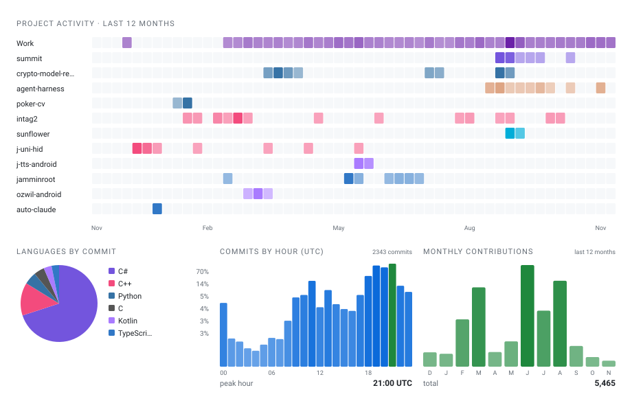
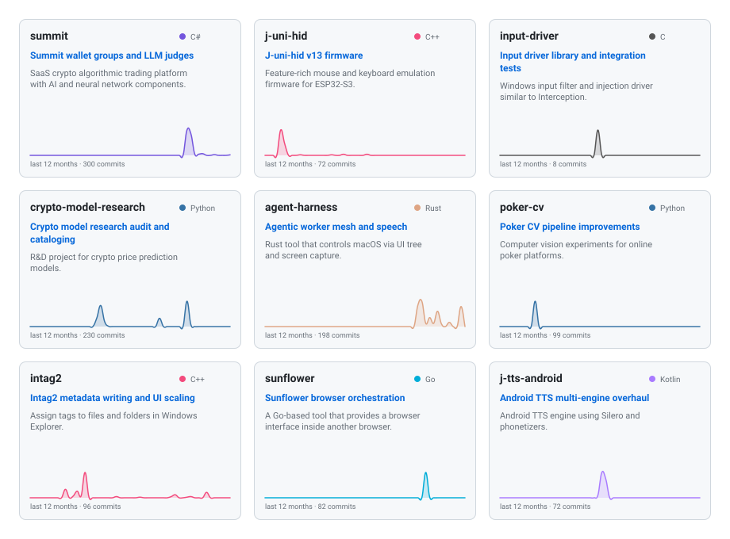

## .NET Software Developer, TechLead at Deeplay.io.

### What a time to be alive!

#### [@jamminroot (telegram)](https://t.me/jamminroot), [Dmitrii Chichuk (LinkedIn)](https://linkedin.com/in/dchichuk)

Feel free to reach out!

<!-- ACTIVITY-SUMMARY-START -->
## Recent activity (last 12 months)

*Auto-generated weekly from commit history · updated 2026-11-02*

Built the SaaS crypto algo trading platform Summit (C#), adding LLM-driven judge seats, wallet-group automation, and rebalancing signals. Developed the j-uni-hid firmware (C++) for ESP32-S3, iterating through multiple HID and BLE generations. Created the input-driver (C), a Windows kernel-mode input filter and injection driver.

Across secondary projects, built the JAW agentic worker (Rust) with a local speech engine and mesh networking, the sunflower browser-isolation platform (Go) with anti-detection and human-input simulation, and the intag2 file-tagging utility (C++) for Windows Explorer. Conducted extensive research in crypto-model-research (Python), building a unified model catalog and drift monitoring pipeline. Also developed the poker-cv computer vision pipeline (Python), the j-tts-android TTS app (Kotlin) with multiple engine support, and the ozwil-android on-device LLM app (Kotlin) with sub-agent delegation.

Other work includes the jamminroot CV generation pipeline, freqtrade_startegies trading strategy catalog, MEMU3 aim-assist project, yolo-labeler annotation tool, papyrix e-ink firmware, jaxon code intelligence engine, various n8n nodes, and dotfiles configuration. The work spans systems programming, machine learning, mobile development, and developer tooling, consistently building from scratch or deeply reworking existing systems.
<!-- ACTIVITY-SUMMARY-END -->

<!-- ACTIVITY-TIMELINE-START -->
> **2026 Nov**
>
> - **Speech and mesh networking for JAW** *(agent-harness)* — Built a local speech engine and mesh networking layer for the JAW agentic worker, adding trust boundaries and Telegram integration.

> **2026 Oct**
>
> - **Wallet groups and scanner optimization** *(summit)* — Reworked wallet-group proposal execution and session persistence; optimized the scanner to skip already-evaluated lanes.
> - **Book memory and state snapshots** *(agent-harness)* — Investigated book memory and local inference performance; improved document handling, state snapshots, and Telegram answer formatting.
> - **Validator and UI improvements** *(yolo-labeler)* — Added a validator, constraint highlighting, and UI improvements to the YOLO labeler.

> **2026 Sep**
>
> - **LLM judges and wallet-group rework** *(summit)* — Built a System One judge seat and TypeSafe provider for LLM-driven decisions; reworked copy management, rebalancing, and the admin backtest configurator.
> - **Matroska tagging and DPI scaling** *(intag2)* — Added Matroska and WebP metadata writing, monitor DPI scaling, and window resizing to the Explorer tagging utility.
> - **Font packs and human-input simulation** *(sunflower)* — Reworked font pack delivery, container lifecycle management, and human-input simulation for the browser-isolation platform.
> - **Stream categorisation and prompts** *(agent-harness)* — Refined stream categorisation rules, tool result handling, and prompt caching for the agentic worker.

> **2026 Aug**
>
> - **Follows, rebalance, and exit simulator** *(summit)* — Built an interactive exit simulator and trailing slider for follows; added calm-liquidity backtest replay and rebalance signals.
> - **Model catalog and drift monitoring** *(crypto-model-research)* — Audited and catalogued 11 distinct models under a unified protocol; built drift monitoring, day reconciliation tooling, and a validation response package for Summit.
> - **Settings and Explorer refresh fixes** *(intag2)* — Fixed settings persistence and Explorer refresh issues in the file-tagging utility.
> - **Browser identity and movement planning** *(sunflower)* — Added browser identity reporting, permission prompt handling, and human-like movement planning; refactored the fence grant system.

> **2026 Jul**
>
> - **Vorbis tagging and CI cleanup** *(intag2)* — Added Vorbis comment writing for Ogg files and fixed the shell extension uninstall path; collapsed the release CI workflow.
> - **Pack-relative reversion strategies** *(freqtrade_startegies)* — Added pack-relative and BTC-relative reversion strategies to the trading strategy catalog.

> **2026 Jun**
>
> - **CV pipeline and importance tags** *(jamminroot)* — Reworked the CV generation pipeline: added LLM model override, enforced voice consistency, split Deeplay roles, and switched to PRIMARY/SECONDARY/MINOR importance tags.
> - **AutoHotKey alternative with interception** *(jolt)* — Built the jolt AutoHotKey alternative with a scenario engine, interception support, conditions, and stateless themes.
> - **EWO dip-buy strategy family** *(freqtrade_startegies)* — Added a family of EWO dip-buy strategies with trend regimes and DCA averaging for the trading system.

> **2025**
>
> - **ESP32-S3 HID firmware generations** *(j-uni-hid)* — Built multiple firmware generations (v7-v13) for the ESP32-S3 HID emulation device, adding BLE, USB touch, and performance profiles.
> - **Squash merge and Git rules** *(auto-claude)* — Added squash-merge support, a Git rules system, and task ID tracking to the autonomous coding agent.
> - **USB-HID mouse emulation** *(MEMU3)* — Integrated USB-HID mouse emulation and added operating modes to the aim-assist project.
> - **Docker deployment and auth fixes** *(n8n-nodes-telepilot-2)* — Added Docker and Alpine Linux deployment support; fixed authentication and session handling in the n8n TelePilot nodes.
> - **Trading strategy iterations** *(freqtrade_startegies)* — Iterated on trading strategies (jNASOS, SimpleEMA, Fenix), refactoring entry signals and parameters for improved backtesting performance.
> - **Summarization and multi-target sending** *(pAssistant)* — Added summarization, multi-target sending, and image deduplication to the Telegram assistant.
> - **Web app and profit calculations** *(freqtrade-tg-multibot)* — Built a web application with Docker support, reworked Telegram authentication, and improved daily profit calculations for the multi-bot trading monitor.
> - **Flutter monitoring UI** *(freqtrade_monitor)* — Built a Flutter monitoring app with glassy cards, win-rate bar charts, and import/export functionality.
> - **Poker CV pipeline rework** *(poker-cv)* — Reworked the poker CV pipeline, achieving 99% hand detection and 97.8% board card accuracy.
> - **Windows input filter driver** *(input-driver)* — Released v1.2 of the Windows input filter driver with HardwareId filtering, library predicates, and an integration-test runner.
> - **TTS engine overhaul** *(j-tts-android)* — Removed legacy TTS engines, added F5-TTS and Piper support, and ported RuNorm to Kotlin for the Android TTS app.
> - **Sub-agent architecture rewrite** *(ozwil-android)* — Rewrote the sub-agent architecture with session-based delegation, added model settings hub, and improved tool routing strategies for the on-device LLM app.
> - **Map and Knowledge Base apps** *(papyrix)* — Added a Map app with tile viewer, a Knowledge Base app with taxonomy browser, and fixed FB2 encoding support for the e-ink reader firmware.
> - **LSP and DI detection** *(jaxon)* — Added LSP integration, DI registration detection, and tree-sitter parsers for C++, Go, Rust, and Svelte to the code intelligence engine.
> - **Neovim IDE configuration** *(.dotfiles)* — Set up a full Neovim IDE config with LSP, treesitter, and secret detection pre-commit hook.
> - **Eink reader launcher** *(blackboard-launcher)* — Built the Blackboard launcher for Eink readers with Onyx SDK drawing, gesture zones, and status bar control.
> - **Claude Agent SDK migration** *(n8n-nodes-claudecode)* — Migrated the n8n node to the Claude Agent SDK and fixed abort controller cleanup.
> - **XHTTP transport support** *(FlCLash)* — Added XHTTP transport support via a rebased Clash.Meta fork for the Flutter Clash client.
> - **E-ink reader firmware update** *(biscuit)* — Added a Knowledge Base app and FB2 reader to the e-ink reader firmware.

> **2024**
>
> - **Telegram assistant maintenance** *(pAssistant)* — Improved error logging, fixed forwarding bugs, and updated the store layer for the Telegram assistant.
<!-- ACTIVITY-TIMELINE-END -->

[**Download CV (PDF)**](https://raw.githubusercontent.com/Jamminroot/Jamminroot/master/cards/cv.pdf)
